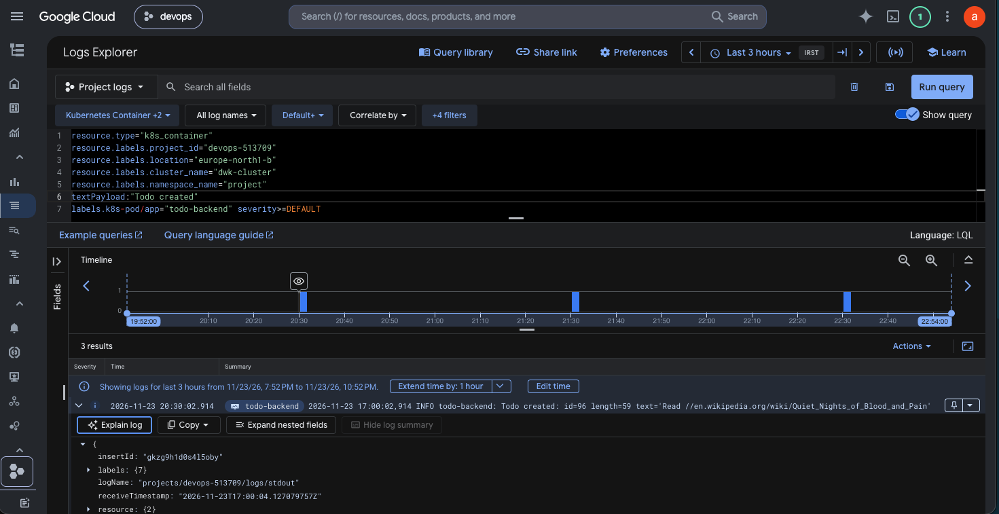

# Application logs in GKE

GKE ships container stdout/stderr to **Cloud Logging** automatically
(system and workload logging are on by default). Metrics such as CPU and memory
go to **Cloud Monitoring**.

## Make sure logging/monitoring is enabled

```bash
gcloud container clusters describe dwk-cluster --zone=europe-north1-b \
  --format="value(loggingConfig.componentConfig.enableComponents,monitoringConfig.componentConfig.enableComponents)"
```

If `WORKLOADS` is missing from the logging components, enable it:

```bash
gcloud container clusters update dwk-cluster --zone=europe-north1-b \
  --logging=SYSTEM,WORKLOAD --monitoring=SYSTEM
```

## Finding the project's logs

Cloud Console → **Logging → Logs Explorer**
(or Kubernetes Engine → Workloads → `todo-backend-dep` → **Logs** tab).

Query for the todo backend in the `project` namespace:

```
resource.type="k8s_container"
resource.labels.cluster_name="dwk-cluster"
resource.labels.namespace_name="project"
resource.labels.container_name="todo-backend"
```

Add `textPayload:"Todo created"` to show only new todos. The same query works from the CLI:

```bash
gcloud logging read 'resource.type="k8s_container" AND resource.labels.namespace_name="project" AND resource.labels.container_name="todo-backend" AND textPayload:"Todo created"' --limit=10 --freshness=1h
```

## A new todo in the logs

After creating a todo in the app, the backend logs
`Todo created: id=<id> length=<n> text='<text>'`:


